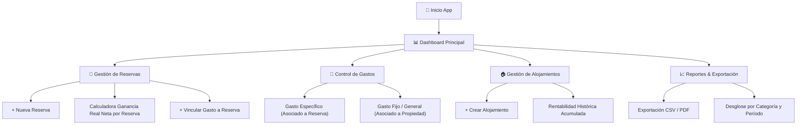

# RentaRent MVP — Arquitectura & Especificación Técnica

## 1. Visión del Producto
**RentaRent** es una aplicación Web/Mobile (PWA & Android WebView Wrapper) orientada exclusivamente a propietarios de 1 a 10 alojamientos temporarios (Airbnb, Booking.com, alquiler directo). 
Su objetivo central es responder a la pregunta de negocio:  
> **"¿Cuánto dinero ganó realmente el propietario después de todos los gastos y comisiones asociados a cada reserva?"**

---

## 2. Diagrama de Navegación & Flujo


---

## 3. Estructura de Datos (LocalStorage Schema)

```json
{
  "renta_properties_v1": [
    {
      "id": "prop_1711800000000",
      "nombre": "Departamento Centro 2B",
      "direccion": "Av. Libertador 1200, 2B",
      "tipo": "Apartamento"
    }
  ],
  "renta_bookings_v1": [
    {
      "id": "res_1711800000100",
      "propertyId": "prop_1711800000000",
      "huesped": "Martín Gómez",
      "fechaEntrada": "2026-10-05",
      "fechaSalida": "2026-10-10",
      "canal": "Airbnb",
      "importeCobrado": 450000
    }
  ],
  "renta_expenses_v1": [
    {
      "id": "gas_1711800000200",
      "propertyId": "prop_1711800000000",
      "bookingId": "res_1711800000100",
      "fecha": "2026-10-05",
      "categoria": "Comisión Airbnb",
      "importe": 67500,
      "descripcion": "Comisión del 15% de la plataforma"
    }
  ]
}
```

---

## 4. Algoritmo de Cálculo: Ganancia Real por Reserva

$$\text{Ganancia Neta} = \text{Ingreso Bruto} - \left( \sum \text{Comisiones} + \sum \text{Limpieza} + \sum \text{Otros Gastos Reserva} \right)$$

$$\text{Margen de Ganancia \%} = \left( \frac{\text{Ganancia Neta}}{\text{Ingreso Bruto}} \right) \times 100$$

---

## 5. Estrategia de Monetización Integrada

| Nivel | Límite de Propiedades | Funcionalidades | Precio |
|---|---|---|---|
| **Plan Gratis** | 1 Propiedad | Dashboard completo, reservas ilimitadas, exportación CSV | **$0 / mes** |
| **Plan Premium** | Propiedades Ilimitadas | Exportación PDF oficial, métricas RevPAR/ADR avanzadas, multi-dispositivo | **$9.99 / mes** |

---

## 6. Roadmap para Versión 2.0

1. **Integración con Calendarios iCal**: Sincronización automática de reservas desde Airbnb y Booking vía URL iCal sin API paga.
2. **Exportador PDF Oficial**: Generación local de resúmenes ejecutivos listos para enviar a contadores o socios inversores.
3. **Multi-Moneda & Tipo de Cambio**: Manejo dinámico de cobros en USD/EUR con cotización oficial/paralela diaria.
4. **Recordatorios de Check-in / Limpieza**: Notificaciones locales en dispositivo para coordinar equipos de limpieza entre reservas.
